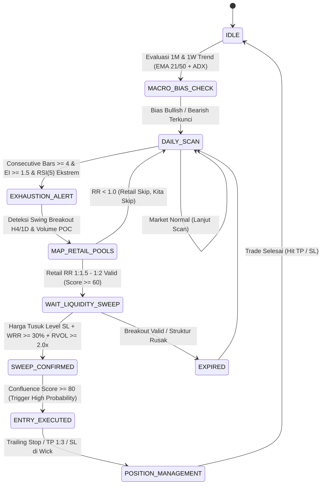

# PRD: Quantitative Market Analyst & Multi-Asset Backtesting Engine

> **Dokumen Spesifikasi Produk (Product Requirements Document)**  
> **Nama Proyek**: `Analysis-Market`  
> **Target Instrumen**: Forex (`XAUUSD`) & Cryptocurrency (`BTC`, `ETH`, `BNB`, `SOL`, `DOGE`, `PEPE`, dsb.)  
> **Pendekatan Analisis**: Multi-Timeframe Analysis (MTF), Dynamic ATR Time-Bar Exhaustion, Retail Risk-Reward (RR) Liquidity Sweep, dan Smart Money Concepts (SMC).  
> **Status Dokumen**: `APPROVED & LOCKED IN SESSION STATE`

---

## 1. Executive Summary & Visi Sistem

Sistem **`Analysis-Market`** adalah platform analitik kuantitatif dan mesin *backtesting* berbasis web yang mentransformasi perilaku psikologi retail (*retail traps*) dan konsep pergerakan uang institusional (*Smart Money Concepts / SMC*) menjadi aturan matematis deterministik (*rule-based algorithmic system*).

Sistem ini dirancang untuk:
1. **Memetakan Siklus Tren Multi-Timeframe (MTF)**: Membaca struktur pasar makro (1 Bulan & 1 Minggu) untuk memproyeksikan probabilitas arah harian (1 Hari) dan jam (H4 / H1).
2. **Mendeteksi Titik Kejenuhan Tren (*Time-Bar Exhaustion*)**: Mengukur batas kenaikan/penurunan berturut-turut (maksimal 3–5 bar) menggunakan normalisasi volatilitas dinamis (*Average True Range / ATR*).
3. **Mengidentifikasi Jebakan Likuiditas Retail (*Retail RR Traps*)**: Menghitung secara algoritmik posisi Stop Loss (SL) retail yang memasang rasio Risk-to-Reward (RR) 1:1.5 hingga 1:2 pada pola *breakout/breakdown*.
4. **Eksekusi Pasca-Sweep (*Liquidity Swept Confirmation*)**: Menghasilkan sinyal masuk (*entry*) berprobabilitas tinggi HANYA setelah likuiditas retail terjemput oleh *market maker* dan dikonfirmasi oleh penolakan harga (*rejection wick / pinbar*) serta pergeseran struktur (*Market Structure Shift / MSS*).
5. **Menyediakan Mesin Backtest Berkecepatan Tinggi**: Menguji keandalan skema strategi ini pada ribuan candle historis Forex dan Crypto tanpa bias intip masa depan (*Zero Look-Ahead Bias*) dengan memperhitungkan *spread*, *slippage*, dan biaya komisi riil.

---

## 2. Evaluasi Kritis Asumsi Pasar (Apa yang Kurang & Solusinya)

Menjawab pertanyaan pengguna: *"Apakah skema ini bisa di-backtest? Dan apakah ada yang kurang?"*  
**Jawabannya: SANGAT BISA.** Namun, terdapat **7 celah logika dan parameter** yang wajib dikoreksi agar hasil pengujian mencerminkan realitas pasar dan tidak bias.

### Evaluasi 1: Masalah Kenaikan Rata-Rata Statis "2%–5%" per Hari
* **Celah Logika**: Menerapkan persentase statis (2%–5%) secara seragam antara Forex (XAUUSD) dan Crypto (BTC hingga Meme Coin PEPE/DOGE) adalah kesalahan fatal:
  - **XAUUSD (Gold)**: *Average Daily Range (ADR)* emas normalnya hanya **0.5% hingga 1.5%**. Kenaikan 3%–5% dalam satu hari di Gold adalah anomali ekstrem (misal rilis berita perang atau lonjakan inflasi mendadak). Jika sistem menunggu kenaikan 3% harian di Gold, sinyal trade tidak akan pernah muncul.
  - **Meme Coins (PEPE, DOGE) & Altcoins (SOL)**: Volatilitas harian saat trending seringkali melampaui **8% hingga 25%+**. Batas maksimal 5% akan membuat sistem menganggap tren sudah selesai padahal baru saja dimulai.
* **Solusi Sistem**: **Hapus persentase statis**. Gunakan indikator **ATR (Average True Range) 14 periode** yang dinormalisasi untuk masing-masing aset:
  $$\text{Exhaustion Multiplier} = \frac{|\text{Close}_t - \text{Open}_{t-k}|}{\text{ATR}_{14}}$$

### Evaluasi 2: Aturan "Maksimal 5 Bar Chart Berturut-Turut" vs Parabolic Run
* **Celah Logika**: Secara statistik pada timeframe Daily (1D), 3–5 candle searah sering memicu koreksi (*profit-taking*). Namun, saat terjadi reli parabolik (*parabolic bull run*, misal BTC menembus All-Time High atau PEPE mengalami viral hype), market bisa mencetak 7 hingga 10 bar hijau berturut-turut tanpa koreksi berarti. Jika sistem langsung melakukan *counter-trend* (melawan arah) di bar ke-5, akun akan terkena *stop loss* beruntun.
* **Solusi Sistem**: Jadikan "5 Bar Berturut-turut" sebagai **Status Peringatan (Alert Zone / Ready for Reversal)**, **BUKAN pemicu eksekusi langsung**. Eksekusi entry tetap mutlak menunggu konfirmasi *Liquidity Sweep* di lower timeframe (H1/H4).

### Evaluasi 3: Logika Kuantifikasi Retail Liquidity & Rasio RR 1:1.5 s.d 1:2
* **Celah Logika**: Komputer tidak memiliki data langsung mengenai Stop Loss retail perorangan. Namun, retail trading diajarkan melalui buku teks teknikal klasik yang seragam:
  1. Entry pada *Breakout Resistance* atau *Breakdown Support*.
  2. Memasang Stop Loss tepat di balik *Swing High/Low* lokal terdekat.
  3. Memasang Take Profit dengan target rasio $RR \ge 1:1.5$ atau $1:2$.
  4. Jika jarak ke *Resistance/Support* berikutnya terlalu sempit sehingga rasio RR kurang dari 1:1, retail disiplin akan melewatkan (*skip*) trade tersebut.
* **Solusi Sistem**: Algoritma mendeteksi fraktal *Swing High/Low*. Dari titik breakout, hitung jarak Stop Loss ($R$) dan jarak Take Profit ke struktur berikutnya ($T$).
  - Jika $\frac{T}{R} \ge 1.5$ dan $\le 2.5$, tandai area Stop Loss di balik swing tersebut sebagai **`Active Liquidity Pool`** (Likuiditas manis yang diincar bandar).
  - Jika $\frac{T}{R} < 1.5$, tandai sebagai **`Low Probability Pool`** (Skip).

### Evaluasi 4: Pencegahan Bias Intip Masa Depan (*Look-Ahead Bias*)
* **Celah Logika**: Saat melakukan backtest pada timeframe 1 Hari (1D) menggunakan bias tren 1 Minggu (1W), jika sistem membaca candle 1W yang sedang berjalan, sistem melakukan kecurangan matematis (*look-ahead bias*) karena candle 1W belum resmi ditutup.
* **Solusi Sistem**: Slicing data time-series harus строго kausal: kalkulasi bias 1W hanya boleh menggunakan candle 1W yang **telah resmi ditutup** pada akhir pekan sebelumnya.

### Evaluasi 5: Filter Waktu & Sesi Likuiditas (*Session Killzones*)
* **Celah Logika**: Pada instrumen Forex seperti XAUUSD, likuiditas tersebar berdasarkan sesi bursa dunia. Likuiditas di sesi Asia (pagi hari) sangat tipis. Penembusan level di sesi Asia seringkali menghasilkan *fakeout* lemah atau konsolidasi berkepanjangan.
* **Solusi Sistem**: Tambahkan filter **Killzones** untuk Forex:
  - **London Killzone**: 14:00 – 16:00 WIB (07:00 – 09:00 UTC).
  - **New York Killzone**: 19:00 – 22:00 WIB (12:00 – 15:00 UTC).
  - Sinyal sweep di luar sesi likuiditas tinggi akan diturunkan skor probabilitasnya (*confidence score*).

### Evaluasi 6: Data Khusus Derivatif Kripto (*Crypto Market Metrics*)
* **Celah Logika**: Pasar kripto futures memiliki data transparan yang tidak ada di forex konvensional: **Open Interest (OI)**, **Funding Rates**, dan **Liquidation Heatmaps**.
* **Solusi Sistem**: Jika harga bergerak naik 4 bar berturut-turut disertai *Funding Rate* positif ekstrem dan lonjakan *Open Interest*, ini adalah konfirmasi mutlak bahwa retail sedang mengalami FOMO Long. Area likuiditas Stop Loss mereka menjadi magnet berdaya tarik sangat tinggi bagi *market maker*.

### Evaluasi 7: Simulasi Gesekan Transaksi Riil (*Slippage, Spread, & Fees*)
* **Celah Logika**: Token seperti DOGE dan PEPE memiliki *spread* dan *slippage* yang cukup besar saat terjadi lonjakan volatilitas. Menguji strategi tanpa biaya transaksi akan menghasilkan ilusi profitabilitas (*backtest fantasy*).
* **Solusi Sistem**: Backtest engine wajib memotong:
  - Forex (XAUUSD): Spread rata-rata 15–30 cents.
  - Crypto: Taker fee 0.05% per transaksi + slippage dinamis 0.05%–0.1%.

---

## 3. Formulasi Matematis & State Machine Algoritma

### 3.1 Model Matematika & Kuantifikasi Psikologi Retail

Untuk menerjemahkan logika *"Retail masuk jika RR $\ge$ 1:1.5, dan kita masuk setelah SL retail kena (Sweep)"*, titik-titik harga didefinisikan secara matematis:

#### 1. Identifikasi Struktur Fraktal (5-Bar Fractal)
Sebuah candle pada indeks $i$ disebut **Swing Low ($SL_{local}$)** jika titik terendahnya ($Low_i$) lebih rendah dari 2 candle di kiri dan 2 candle di kanannya:
$$Low_i < Low_{i-1}, Low_{i-2} \quad \text{dan} \quad Low_i < Low_{i+1}, Low_{i+2}$$

Sebaliknya, candle disebut **Swing High ($SH_{local}$)** jika titik tertingginya ($High_i$) lebih tinggi dari 2 candle di kiri dan 2 candle di kanannya:
$$High_i > High_{i-1}, High_{i-2} \quad \text{dan} \quad High_i > High_{i+1}, High_{i+2}$$

> **Catatan Kausalitas Anti Look-Ahead**: Dalam backtesting, konfirmasi Swing Low/High pada bar $i$ baru sah diketahui setelah bar $i+2$ resmi ditutup.

#### 2. Kalkulasi RR Retail (Simulasi Psikologi Retail)
Misalkan market sedang **Uptrend** di timeframe 1W, dan sedang mengalami koreksi turun selama 3–5 bar di 1D. Retail bersiap melakukan **Buy on Support / Breakout Kecil** di harga estimasi ($P_{retail}$):
- **Estimasi Titik Buy Retail**:
  $$P_{retail} = SL_{local} + (0.3 \times ATR_{14})$$
- **Titik Stop Loss Retail ($L_{pool}$)**: Diletakkan sedikit di bawah Swing Low terdekat:
  $$L_{pool} = SL_{local} - (0.1 \times ATR_{14})$$
- **Risiko Retail ($R_{retail}$)**:
  $$R_{retail} = |P_{retail} - L_{pool}|$$
- **Target Profit Retail ($T_{retail}$)**: Jarak ke Resistance mayor terdekat ($SH_{major}$):
  $$T_{retail} = |SH_{major} - P_{retail}|$$
- **Rasio RR Retail ($RR_{retail}$)**:
  $$RR_{retail} = \frac{T_{retail}}{R_{retail}}$$

#### 3. Aturan Filter Likuiditas Sistem
- **Active Liquidity Pool**: Jika $RR_{retail} \ge 1.5$ (1:1.5 hingga 1:2). Retail bersemangat entry, area $L_{pool}$ menjadi target perburuan likuiditas (*liquidity magnet*).
- **Invalid / Skip Pool**: Jika $RR_{retail} < 1.0$ (risiko lebih besar daripada potensi profit). Retail disiplin akan *skip* (tidak berani entry). Sistem kita tidak akan menunggu *sweep* di level tersebut karena tidak ada kerumunan order SL yang signifikan.

#### 4. Konfirmasi *Liquidity Sweep* & *Rejection Wick Ratio (WRR)*
Pada candle lower timeframe (H4/H1):
- **Penetration**: $Low_t < L_{pool}$ (Stop Loss retail tersapu).
- **Rejection Close**: $Close_t > SL_{local}$ (Harga memantul kembali di atas level struktur).
- **Wick Rejection Ratio**:
  $$WRR = \frac{\min(Open_t, Close_t) - Low_t}{High_t - Low_t} \ge 0.30 \quad (\ge 30\% \text{ ekor bawah})$$

---

### 3.2 Pseudocode Engine Backtest (Python Style)

```python
def evaluate_market_setup(df_1w, df_1d, df_4h):
    """
    df_1w : DataFrame Weekly (Bias Makro - Closed Bar)
    df_1d : DataFrame Daily (Siklus Bar & Exhaustion)
    df_4h : DataFrame H4 (Deteksi Liquidity Retail & Trigger Sweep)
    """
    
    # 1. CEK SIKLUS MAKRO (1 MINGGU UNTUK 1 BULAN/MINGGUAN)
    macro_trend = "BULLISH" if df_1w['close_px'].iloc[-1] > df_1w['ema_20'].iloc[-1] else "BEARISH"
    
    # 2. CEK SIKLUS BAR HARIAN (MAKSIMAL 5 BAR & VOLATILITAS ATR)
    consecutive_red_bars = count_consecutive_bars(df_1d, direction="DOWN")
    daily_atr_pct = (df_1d['atr_14'].iloc[-1] / df_1d['close_px'].iloc[-1]) * 100
    
    # Skenario: Mencari setup BUY saat Macro Bullish & Daily sedang koreksi turun (3-5 bar)
    if macro_trend == "BULLISH" and (3 <= consecutive_red_bars <= 5):
        
        # 3. DETEKSI LIQUIDITY POOL RETAIL DI H4
        swing_low = get_last_swing_low(df_4h, order=2)     # Support tempat retail taruh SL Buy
        swing_high = get_last_swing_high(df_4h, order=2)   # Resistance tempat retail taruh TP
        retail_entry_zone = swing_low + (0.3 * df_4h['atr_14'].iloc[-1]) # Estimasi area buy retail
        l_pool = swing_low - (0.1 * df_4h['atr_14'].iloc[-1])
        
        retail_risk = abs(retail_entry_zone - l_pool)
        retail_reward = abs(swing_high - retail_entry_zone)
        
        if retail_risk <= 0:
            return "NO_SETUP"
            
        retail_rr = retail_reward / retail_risk
        
        # FILTER UTAMA: Retail hanya masuk jika RR >= 1.5 (1:1.5 atau 1:2)
        if retail_rr < 1.5:
            return "SKIP: Retail RR tidak menarik, Liquidity tidak terbentuk"
            
        # 4. CEK APAKAH LIQUIDITY SUDAH DIJEMPUT (SWEEP TRIGGER)
        current_candle = df_4h.iloc[-1]
        candle_range = current_candle['high_px'] - current_candle['low_px']
        
        # Syarat Sweep: Low menembus l_pool, TAPI body candle ditutup kembali di atas Swing Low
        is_swept = (current_candle['low_px'] < l_pool) and (current_candle['close_px'] > swing_low)
        lower_wick = min(current_candle['open_px'], current_candle['close_px']) - current_candle['low_px']
        has_rejection = (lower_wick / candle_range) >= 0.30 if candle_range > 0 else False
        
        if is_swept and has_rejection:
            entry_price = current_candle['close_px']
            stop_loss = current_candle['low_px'] - (0.2 * df_4h['atr_14'].iloc[-1]) # SL di bawah ekor sweep
            take_profit = swing_high # Target di resistance mayor
            
            return {
                "signal": "BUY_AFTER_SWEEP",
                "entry": entry_price,
                "sl": stop_loss,
                "tp": take_profit,
                "retail_rr_trapped": round(retail_rr, 2)
            }
            
    return "WAITING_FOR_SWEEP"
```

---

### 3.3 Toolkit Indikator Presisi & Confluence Score System (0–100%)

Untuk mencegah penggunaan indikator retail yang *lagging* (seperti MACD standar atau Stochastic lambat), sistem memadukan indikator kuantitatif spesifik:

#### 1. Matriks 5 Kategori Indikator Kuantitatif

| Kategori Analisis | Indikator Presisi | Fungsi Spesifik dalam Algoritma |
| :--- | :--- | :--- |
| **A. Siklus Makro (1M & 1W)** | **EMA 21 & EMA 50 + ADX (14)** | Menentukan arah tren institusional dan menyaring pasar *ranging/sideways* parah (ADX > 25 = Strong Trend). |
| **B. Kejenuhan 5 Bar (1D)** | **ATR (14) Dynamic Bands + RSI (5)** | Mengukur batas wajar volatilitas aset ($\ge 1.5\text{x}-2.0\text{x } ATR_{14}$) dan mendeteksi titik jenuh ekstrem via RSI periode 5 (< 15-20 oversold, > 80-85 overbought). |
| **C. Peta Likuiditas Retail (H4/H1)** | **Williams Fractals (5-Bar) + Volume Profile (POC)** | Menemukan titik fraktal tempat retail menaruh Stop Loss ($L_{pool}$) dan tumpukan volume transaksi tertinggi tempat retail entry. |
| **D. Konfirmasi Sweep (Trigger Entry)** | **Relative Volume (RVOL > 2.0x) + RSI Divergence** | Memastikan penembusan support adalah **Sweep (Jebakan)** ber-volume tinggi yang ditolak, bukan *real breakout* lanjutan. |
| **E. Khusus Crypto (BTC, SOL, PEPE)** | **Funding Rate (> 0.03%) + Open Interest (OI) Plunge** | Mendeteksi kerumunan retail FOMO Long ber-leverage dan mengonfirmasi bahwa Stop Loss retail telah bersih terlikuidasi saat OI anjlok seketika. |

#### 2. Mekanisme Kuantitatif & Pembeda Sweep vs Breakout
1. **RSI Periode 5 (RSI-5) vs RSI Standar (RSI-14)**:
   - RSI standar (14) terlalu lambat untuk siklus 3–5 bar. Saat market menyelesaikan koreksi 4 bar harian, RSI-14 seringkali baru berada di level 40–45 (belum oversold).
   - RSI-5 merespons pergerakan 3–5 bar harian secara instan, menyentuh level ekstrem $\le 15$ (*deeply oversold*), memberi sinyal matematis bahwa tekanan jual harian telah habis.
2. **Relative Volume (RVOL) pada Ekor Candle (*Wick Spike*)**:
   - Saat SL retail tersapu, ribuan *Stop-Market Orders* terpicu serentak dan diserap oleh *Limit Orders* institusi.
   - Hasilnya: Volume melonjak tajam ($RVOL \ge 2.0\times$ volume rata-rata 20 bar terakhir), namun candle menolak tutup di bawah support (*rejection wick*).
3. **Anjloknya Open Interest (OI Plunge) di Pasar Kripto**:
   - Jika harga menembus support dan OI **naik**, artinya ada *trader* baru yang agresif membuka posisi *Short* (*Real Breakdown*).
   - Jika harga menembus support dan OI **anjlok drastis**, artinya ribuan posisi retail baru saja terlikuidasi / terkena Stop Loss (*Liquidity Sweep Confirmed*). Ini adalah konfirmasi mutlak bahwa likuiditas telah terjemput bersih!

#### 3. Sistem Pembobotan Confluence Score (0–100 Poin)
Di dashboard web, setiap setup diberi skor probabilitas matematis terbobot:

```
┌────────────────────────────────────────────────────────────────────────┐
│                   FORMULA CONFLUENCE SCORE (0 - 100%)                  │
├───────────────────────────────────────────────────────────┬────────────┤
│ Komponen Evaluasi Algoritma                               │ Bobot Skor │
├───────────────────────────────────────────────────────────┼────────────┤
│ 1. Siklus 1W & 1M Searah (EMA 21 > EMA 50 & ADX 14 > 25)  │  +20 Poin  │
│ 2. Siklus Harian 3–5 Bar & Kumulatif >= 1.5x ATR & RSI-5  │  +20 Poin  │
│ 3. Pool Likuiditas Retail Terdeteksi (Fraktal & RR >= 1.5)│  +20 Poin  │
│ 4. Harga Menjemput Pool + Pinbar Rejection & RVOL >= 2.0x │  +25 Poin  │
│ 5. Konfirmasi Tambahan (RSI Divergence / OI Plunge Kripto)│  +15 Poin  │
├───────────────────────────────────────────────────────────┴────────────┤
│ ATURAN EKSEKUSI: Total Skor >= 80 Poin => "HIGH PROBABILITY SWEEP"     │
└────────────────────────────────────────────────────────────────────────┘
```

---

### 3.4 Finite State Machine (Alur 8-Fase)



---

## 4. Arsitektur Tech Stack Sistem Web

Arsitektur aplikasi dibangun dengan memisahkan engine komputasi kuantitatif berkecepatan tinggi di backend dan antarmuka interaktif responsif di frontend:

```
┌────────────────────────────────────────────────────────────────────────┐
│                   FRONTEND: Next.js 15 & React 19                      │
│   - TradingView Lightweight Charts (v4/v5 Custom Overlay Canvas)       │
│   - Multi-Timeframe Heatmap Matrix (1M, 1W, 1D, H4, H1)                │
│   - Backtest Visualizer (Equity Curve, KPI Scorecard, Trade Log)       │
└───────────────────────────────────┬────────────────────────────────────┘
                                    │ HTTP REST & WebSocket
                                    ▼
┌────────────────────────────────────────────────────────────────────────┐
│                   BACKEND: Python 3.11+ & FastAPI                      │
│   - Strategy Engine: VectorBT / Backtesting.py + NumPy/Pandas          │
│   - Ingestion Pipeline: CCXT (Crypto) + MetaTrader 5 API (Forex)       │
│   - WebSocket Broadcaster (Realtime OHLCV & Signal Feeds)              │
│   - Redis Queue: Celery Task Worker untuk Backtest Berat               │
└───────────────────────────────────┬────────────────────────────────────┘
                                    │
                                    ▼
┌────────────────────────────────────────────────────────────────────────┐
│                 DATABASE: PostgreSQL 16 + TimescaleDB                  │
│   - Hypertable: `candles` (1m, 1h, 4h, 1d, 1w, 1M dengan Chunk 7 Hari)│
│   - Hypertable: `crypto_market_metrics` (Funding Rate, Open Interest)  │
│   - Relational Tables: `assets`, `liquidity_pools`, `backtest_runs`    │
│   - Compression Policy: Kompresi otomatis data > 30 hari (Hemat 90%)   │
└────────────────────────────────────────────────────────────────────────┘
```

---

## 5. Skema Basis Data Lengkap (PostgreSQL / TimescaleDB DDL)

Skema database dirancang ringkas, terstandarisasi, dan mendukung *multi-timeframe* berkecepatan tinggi:

```sql
-- 1. Enable Extension
CREATE EXTENSION IF NOT EXISTS timescaledb CASCADE;

-- 2. Master Aset & Karakteristik Pasar (mst_asset)
-- Menyimpan profil unik tiap pair agar aturan kenaikan harian tidak dipukul rata
CREATE TABLE IF NOT EXISTS mst_asset (
    asset_id SERIAL PRIMARY KEY,
    symbol VARCHAR(20) UNIQUE NOT NULL,       -- Contoh: 'XAUUSD', 'BTCUSDT', 'PEPEUSDT'
    asset_cat VARCHAR(15) NOT NULL,           -- 'FOREX', 'CRYPTO_MAJOR', 'CRYPTO_MEME'
    max_bar_cycle INT DEFAULT 5,              -- Batas maksimal bar searah (default: 5)
    avg_daily_pct NUMERIC(5,2) NOT NULL,      -- Rata-rata gerak harian (XAU: 1.00, BTC: 3.00, PEPE: 10.00)
    max_daily_pct NUMERIC(5,2) NOT NULL,      -- Batas jenuh harian (XAU: 2.50, BTC: 5.00, PEPE: 20.00)
    min_retail_rr NUMERIC(4,2) DEFAULT 1.50,  -- Ambang batas RR retail (1.5 = 1:1.5)
    spread_bps NUMERIC(6,2) DEFAULT 5.00,     -- Estimasi biaya spread/slippage untuk backtest
    is_active BOOLEAN DEFAULT TRUE,
    created_at TIMESTAMPTZ DEFAULT NOW()
);

-- 3. Data Candle Multi-Timeframe (mkt_ohlcv - TimescaleDB Hypertable)
-- Menyimpan data historis untuk timeframe 1M, 1w, 1d, 4h, dan 1h
CREATE TABLE IF NOT EXISTS mkt_ohlcv (
    asset_id INT NOT NULL REFERENCES mst_asset(asset_id) ON DELETE CASCADE,
    tf VARCHAR(5) NOT NULL,                   -- '1M', '1w', '1d', '4h', '1h'
    open_time TIMESTAMPTZ NOT NULL,
    open_px NUMERIC(18,8) NOT NULL,           -- 8 desimal untuk mengakomodasi harga PEPE (0.0000xxxx)
    high_px NUMERIC(18,8) NOT NULL,
    low_px NUMERIC(18,8) NOT NULL,
    close_px NUMERIC(18,8) NOT NULL,
    vol NUMERIC(24,4) DEFAULT 0,
    atr_14 NUMERIC(18,8),                     -- Nilai ATR(14) yang sudah dihitung
    consec_bar INT DEFAULT 0,                 -- +3 (3 bar naik berturut), -4 (4 bar turun berturut)
    is_closed BOOLEAN DEFAULT TRUE,           -- Mencegah look-ahead bias saat backtesting
    PRIMARY KEY (asset_id, tf, open_time)
);

SELECT create_hypertable('mkt_ohlcv', 'open_time', 
    chunk_time_interval => INTERVAL '7 days', 
    if_not_exists => TRUE
);

CREATE INDEX IF NOT EXISTS idx_mkt_ohlcv_lookup 
ON mkt_ohlcv (asset_id, tf, open_time DESC);

-- 4. Peta Titik Likuiditas Retail (anl_liq_pool)
-- Menyimpan zona-zona di mana sistem mendeteksi kerumunan SL Retail beserta statusnya
CREATE TABLE IF NOT EXISTS anl_liq_pool (
    pool_id BIGSERIAL PRIMARY KEY,
    asset_id INT NOT NULL REFERENCES mst_asset(asset_id) ON DELETE CASCADE,
    tf VARCHAR(5) NOT NULL,
    formed_at TIMESTAMPTZ NOT NULL,           -- Waktu swing high/low terbentuk
    pool_type VARCHAR(10) NOT NULL,           -- 'BUY_SL' (di bawah support) atau 'SELL_SL' (di atas resistance)
    pool_px NUMERIC(18,8) NOT NULL,           -- Harga titik likuiditas (Swing High/Low - buffer)
    est_retail_rr NUMERIC(5,2) NOT NULL,      -- Hasil hitungan RR retail (misal: 1.85)
    is_valid_target BOOLEAN NOT NULL,         -- TRUE jika est_retail_rr >= min_retail_rr
    status VARCHAR(15) DEFAULT 'PENDING',     -- 'PENDING', 'SWEPT', 'INVALIDATED'
    swept_at TIMESTAMPTZ,                     -- Waktu ketika harga berhasil menjemput pool ini
    swept_px NUMERIC(18,8),
    invalidated_at TIMESTAMPTZ
);

CREATE INDEX IF NOT EXISTS idx_anl_liq_pool_active 
ON anl_liq_pool (asset_id, tf, status) 
WHERE status = 'PENDING';

-- 5. Jurnal Hasil Backtest (bt_trade_log)
-- Mencatat setiap simulasi transaksi untuk dihitung Winrate, Profit Factor, & Drawdown
CREATE TABLE IF NOT EXISTS bt_trade_log (
    trade_id BIGSERIAL PRIMARY KEY,
    asset_id INT NOT NULL REFERENCES mst_asset(asset_id) ON DELETE CASCADE,
    pool_id BIGINT REFERENCES anl_liq_pool(pool_id),
    macro_bias VARCHAR(10) NOT NULL,          -- Bias 1M/1W saat entry ('BULLISH' / 'BEARISH')
    daily_bar_cnt INT NOT NULL,               -- Bar ke-berapa di 1D saat sinyal muncul (misal: bar ke-4)
    side VARCHAR(5) NOT NULL,                 -- 'LONG' atau 'SHORT'
    entry_time TIMESTAMPTZ NOT NULL,
    entry_px NUMERIC(18,8) NOT NULL,
    sl_px NUMERIC(18,8) NOT NULL,
    tp_px NUMERIC(18,8) NOT NULL,
    exit_time TIMESTAMPTZ,
    exit_px NUMERIC(18,8),
    fees_paid NUMERIC(18,8) DEFAULT 0,
    pnl_pct NUMERIC(8,2),                     -- Persentase profit/loss bersih setelah dikurangi spread
    result VARCHAR(10)                        -- 'WIN', 'LOSS', 'BREAKEVEN'
);

CREATE INDEX IF NOT EXISTS idx_bt_trade_log_asset 
ON bt_trade_log (asset_id, entry_time DESC);

-- Kebijakan Kompresi TimescaleDB (Otomatis kompresi mkt_ohlcv > 30 hari)
ALTER TABLE mkt_ohlcv SET (
    timescaledb.compress,
    timescaledb.compress_segmentby = 'asset_id, tf',
    timescaledb.compress_orderby = 'open_time DESC'
);

SELECT add_compression_policy('mkt_ohlcv', INTERVAL '30 days', if_not_exists => TRUE);
```

---

## 6. Spesifikasi Kontrak API (REST & WebSocket)

### 6.1 REST Endpoints

#### 1. `GET /api/v1/market/analysis/current?symbol=XAUUSD`
Mengembalikan status analisis multi-timeframe terkini:
```json
{
  "success": true,
  "data": {
    "symbol": "XAUUSD",
    "market_type": "FOREX",
    "timestamp": "2026-10-17T15:00:00Z",
    "mtf_matrix": {
      "1M": "BULLISH",
      "1W": "BULLISH",
      "1D": "BULLISH_EXHAUSTED",
      "H4": "NEUTRAL_SWEEP_WATCH",
      "H1": "CONSOLIDATION"
    },
    "exhaustion_meter": {
      "consecutive_bars": 4,
      "direction": "UP",
      "atr_14": 28.50,
      "cumulative_move_pct": 3.20,
      "max_daily_pct": 2.50,
      "status": "ALERT_REVERSAL_ZONE"
    },
    "active_liquidity_pools": [
      {
        "pool_id": 102,
        "pool_type": "BUY_SL",
        "pool_px": 2638.50,
        "est_retail_rr": 1.85,
        "is_valid_target": true,
        "status": "PENDING"
      }
    ]
  }
}
```

#### 2. `POST /api/v1/backtest/run`
Memulai simulasi backtest asinkron:
- **Request Body**:
```json
{
  "symbol": "BTCUSDT",
  "timeframe": "4h",
  "start_date": "2025-01-01T00:00:00Z",
  "end_date": "2026-10-01T00:00:00Z",
  "initial_balance": 10000.0,
  "strategy_parameters": {
    "atr_period": 14,
    "max_consecutive_bars": 5,
    "min_retail_rr": 1.5,
    "wick_rejection_ratio": 0.30
  }
}
```
- **Response**: `{ "success": true, "task_id": "8f8b3c12-32a1-4e78-9f12-9c3f81e5b8d2", "status": "QUEUED" }`

#### 3. `GET /api/v1/backtest/{task_id}/results`
Mengembalikan hasil komputasi backtest lengkap: kurva ekuitas harian, metrik risiko (Sharpe, Sortino, Max Drawdown), dan daftar transaksi dari tabel `bt_trade_log`.

---

### 6.2 WebSocket Feed: `ws://localhost:8000/ws/market-feed/{symbol}`
Streaming real-time untuk update status candle dan alert penjemputan likuiditas:
```json
{
  "type": "LIQUIDITY_SWEPT_ALERT",
  "symbol": "BTCUSDT",
  "timeframe": "4h",
  "timestamp": "2026-10-17T15:00:00Z",
  "pool_id": 88,
  "pool_type": "BUY_SL",
  "swept_price": 64200.0,
  "confirmation": "REJECTION_WICK_PINBAR",
  "signal": "BUY_AFTER_SWEEP",
  "suggested_entry": 64550.0,
  "suggested_sl": 64150.0,
  "suggested_tp": 65750.0,
  "trapped_retail_rr": 1.85
}
```

---

## 7. Spesifikasi Antarmuka & Alur Interaksi Web (UI/UX)

Ketika ditampilkan di halaman web dashboard:

### 1. Seleksi Aset & Header
- Pengguna memilih instrumen (misal: **`SOLUSDT`**, **`BTCUSDT`**, atau **`XAUUSD`**).
- Profil karakteristik aset dari tabel `mst_asset` otomatis termuat (`avg_daily_pct`, `max_bar_cycle`, dsb).

### 2. Panel Siklus Tren & Progress Bar Harian
- **Status Siklus Makro**: Menampilkan badge **Siklus 1 Bulan & 1 Minggu** (status: *Uptrend / Downtrend* berbasis EMA 20 dan struktur fraktal).
- **Progress Bar Siklus Harian**:
  - Menampilkan ringkasan status bar harian:
    $$\text{"Saat ini Bar Hijau ke-4 dari maksimal 5 bar, kenaikan hari ini +3.2\% (Status: Siap Reversal / Alert Zone)"}$$
  - Baris indikator visual berubah warna:
    - Bar 1–3: Hijau/Biru (Normal Trend)
    - Bar 4: Orange (Warning Exhaustion)
    - Bar 5: Merah/Kuning Berkedip (Critical Alert - Standby Sweep)

### 3. Tabel Target Liquidity Retail & Alert Real-time
- **Tabel Peta Likuiditas (`anl_liq_pool`)**:
  - Kolom: `Level Harga (Pool Px)`, `Tipe (BUY_SL / SELL_SL)`, `Est. Retail RR`, `Kelayakan (VALID / SKIP)`, `Status (PENDING / SWEPT)`.
  - Area dengan $RR \ge 1.5$ diberi label **`VALID (Target Bandar)`**.
  - Area dengan $RR < 1.0$ (risiko lebih besar daripada profit) diberi label abu-abu **`SKIP (Retail Tidak Masuk)`**.
- **Notifikasi Penjemputan (*Swept Alert*)**:
  - Begitu harga menyentuh $L_{pool}$ dan menolak (*wick rejection*), status di tabel berubah menjadi **`SWEPT (Terjemput)`** dengan highlight emas berkedip dan memunculkan tombol **"Entry Signal BUY/SELL"** lengkap dengan panduan Entry, SL di bawah ekor sweep, dan TP di swing resistance/support berikutnya.

### 4. Chart Interaktif TradingView & Backtest Visualizer
- **TradingView Lightweight Charts Panel**: Menampilkan candlestick dengan overlay kotak semi-transparan untuk area Stop Loss retail dan panah emas tebal tepat di candle penjemput (*sweep marker*).
- **Backtest Scorecard & Trade Log**: Mengagregasikan data tabel `bt_trade_log` menjadi grafik pertumbuhan modal (*Equity Curve*), Winrate %, Profit Factor, dan Maximum Drawdown.

---

## 8. Protokol Validasi Backtesting & Anti-Overfitting

Untuk menjamin bahwa sistem ini tidak hanya bagus di data masa lalu (*curve-fitting* / *overfitting*):

1. **Pemisahan Data In-Sample vs Out-of-Sample (70:30)**:
   - Data historis 70% pertama digunakan untuk kalibrasi parameter (misal nilai $WRR$ dan kelipatan $EI$).
   - Data historis 30% sisanya diuji tanpa mengubah parameter sama sekali. Strategi dianggap valid jika performa Out-of-Sample tidak mengalami degradasi profit factor $> 20\%$.
2. **Walk-Forward Analysis (WFA)**:
   - Menggunakan jendela bergeser (rolling window): 6 bulan optimasi parameter $\rightarrow$ 2 bulan uji blind forward test, diulang sepanjang 3 tahun data historis.
3. **Simulasi Stres Monte Carlo**:
   - Menjalankan 1.000 iterasi pengacakan urutan hasil transaksi (*trade sequence reshuffling*) untuk menguji risiko *worst-case drawdown* dan risiko kebangkrutan (*risk of ruin*).

---

## 9. Roadmap Pengembangan Sistem

| Fase | Milestone & Sasaran | Output Deliverable | Target Waktu |
| :---: | :--- | :--- | :---: |
| **Fase 1** | **Tata Kelola & PRD (Selesai)** | Adopsi tata kelola `.agents` Spoke, PRD.md, dan inisialisasi state | Selesai |
| **Fase 2** | **TimescaleDB & Ingestion Data** | DDL Hypertable, konektor CCXT Crypto & MT5 Forex, pengisian data historis | Sprint 1 |
| **Fase 3** | **Quant Engine & Backtester** | Algoritma Python ATR Exhaustion, Retail RR Mapping, Rejection Wick, VectorBT Runner | Sprint 2 |
| **Fase 4** | **FastAPI API & WebSockets** | REST endpoint analisis MTF, trigger backtest, dan live event broadcaster | Sprint 3 |
| **Fase 5** | **Frontend Next.js & TradingView** | Chart interaktif, overlay box likuiditas, dashboard metrik & visualizer | Sprint 4 |
| **Fase 6** | **Validasi Walk-Forward & Delivery** | Uji Monte Carlo, eliminasi Look-Ahead Bias, Mandatory Delivery Gate | Sprint 5 |
